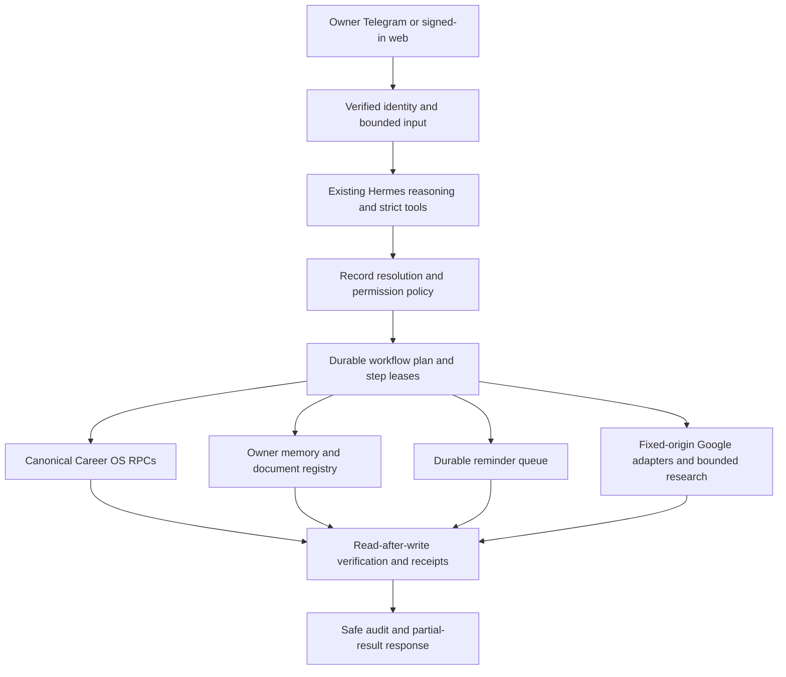

# Career OS Agent V2 design

Date: 29 October 2026. Owner's supplied V2 specification is binding; this document records engineering decisions, not new owner-approved production privileges.

## Intent and approach

Extend the existing personal operating system so one natural-language instruction can safely resolve real records, manage a shared Focus interval, remember explicit preferences, update designated Google files, schedule reminders and execute a durable multi-step plan. Existing user data, canonical task/time accounting and the private owner Telegram boundary must survive.

Approaches considered: (1) extend existing Hermes tools plus PostgreSQL transactions; (2) introduce another agent/orchestration framework; (3) depend on this Codex chat's Google connectors. Choose (1): the runtime already supplies model reasoning, hooks and scheduling, while PostgreSQL can supply durable state. A second framework duplicates infrastructure; chat connector credentials are not application credentials. This is the implementer's choice within the owner's explicit architecture/autonomy requirements.

No model/provider changes, new paid services, production migrations, publication, plugin activation, live jobs, external messages, Google writes or credential rotation. Tests use disposable local fixtures. External authorization and rollout are separate gates.

## Discovered baseline

PR #2 remains draft/unmerged at 5d87e36; correct TanStack base63c172f. Work branch codex/career-os-agent-v2. Lovable remains published at editor4473f372 from9October; existing API/getMe200, control406, controlplugin absent, baseline/rollout gates retained. Hermes uses OpenRouter Muse Contributor, old Telegram toolset, disabled learning job. Six checked protected Google OAuth configuration names are absent. Current baseline: installed compiler and131 tests pass;11 SDK tests pass. New dependency audit advisories require patching (Vite, Vitest, launch-editor, undici, Zod).

## Logical architecture

## Contracts and components

1. **Transport:** keep15 tools. Add one `career_agent` tool with a strict discriminated input schema and server-owned request context. It calls existing authenticated control transport with action `v2`. Reuse actual ingress message records; no caller UID/chat/owner override. Add literal `confirm v2 <UUID>` ingress handling outside model generation. Existing V1 confirmations/guard remain intact; unrelated tools remain denied. New source modules live in src/lib/agent-v2; do not grow the V1 service into a second monolith.
2. **Browser:** authenticated POST /api/v2 resolves user through existing userClient, with bounded JSON and safe errors. Shared V2 service accepts `{uid,source,requestKey,chatRef?,messageRef?,text}` from trusted callers only. Browser request keys are stable UUIDs; agent keys derive from actual message plus operation identity. Reject conflicting payloads. No service key in browser. Real records appear in the existing Agent Activity area, not a parallel Telegram-only app.
3. **Canonical task execution:** Hermes remains the broad natural-language interpreter. Server tools resolve exact IDs/names/context, detect ambiguous/duplicate tasks, and classify stated implementation/learning intent without inventing priority. Preserve existing default priority unless explicitly changed. A bounded `instruction` action supports the specified start/finish/add examples, returns explicit clarification for ambiguous text, and never treats quoted document instructions as owner authority. Unsupported text falls back to existing catalog/resolve/execute tools rather than fabricated understanding.
4. **Shared Focus:** add owner-scoped active interval state, not a second time ledger. Start/pause/resume/finish/cancel use server timestamps and one owner lock/active-row constraint; finalization records exactly once through learning_record_focus into existing focus_sessions. Pause time excluded; whole minutes floor; no rounded-up invented duration. Sub-minute completion can retain measured seconds but records no minute ledger. Completion still obeys evidence/dependency/learning-task guards. Shared hosted UI polls/hydrates server state; demo remains isolated. Legacy local timer requires explicit reconciliation/import with owner-reported provenance or retained legacy completion/discard; never silently discard or double-save it.
5. **Memory:** PostgreSQL owner entries with category/key, bounded JSON value, explicit/inferred provenance, confirmed flag, optimistic version, expiry and tombstone. Only explicit owner-approved preferences may become operational defaults. Contradiction updates require expected version; existing execution history remains authoritative, retrieved memories are data. Secret-like inputs rejected; inferred extraction is a proposal, not an automatic preference. Expose list/correct/forget and bounded retrieval.
6. **Document registry:** PostgreSQL registered Google IDs, kind/title/aliases, designated parent folder, category and owned project/topic association, permitted operations, last revision/sync status. Normalize alias uniqueness per owner; never choose between ambiguous destinations. Credential material is never stored here. Aliases are explicit approved owner data.
7. **Workflows:** persistent plans and individually identified steps, dependencies, immutable action/input hashes, outcomes, permission decisions, attempt counts, leases and correlation IDs. Allowed step kinds map to explicit handlers (Career OS actions, memory, document changes, research and reminder creation), not arbitrary tool names/URLs/code. Atomic claim/finish; successful steps skipped on resume; timeouts external writes become uncertain and require read/reconciliation before retry. Safe failures back off with bounded attempts; cancellation prevents unclaimed steps and reports already-applied effects. Remote writes require a preview bound to exact plan, owner/chat/message confirmation, expiry and observed destination revision. Local changes use canonical RPCs. No pretend distributed transaction; compensation only where exact supported undo is available.
8. **Reminders:** PostgreSQL durable schedule/occurrences/delivery attempts; owner timezone defaults Asia/Kolkata, explicit absolute time or approved default required. Support once/daily/weekly, edit/cancel/upcoming, overdue expiry policy, restart recovery and single-winner SKIP LOCKED claims. Reserve before Telegram send; actual sendMessage receipt required for delivered. Network ambiguity becomes unknown, never blind resend; definite429/5xx retry bounded with retry_after/backoff. Recurrence advances from local wall time with DST tests; ambiguous/nonexistent wall times require clarification. No recurring live job is created/enabled. A reviewed explicit worker command integrates with Hermes cron after approval; polling only reads due durable registrations, not independent task state.
9. **Google:** official REST adapters with per-file drive.file OAuth, server-only protected configuration and fixed HTTPS hosts; reject redirects and arbitrary origins. Refresh tokens never go to tools/DB/logs. Registry permission plus workflow approval required for writes. Read Docs with tabs, find unique heading/paragraph, preserve formatting using targeted requests and requiredRevisionId; reread to verify and store revision. Sheets operations are bounded explicit cells/rows using RAW or string cell types, no formula injection by default. Native Sheets batchUpdate is atomic within one batch but does NOT offer Docs-style revision CAS: use expected-cell/Drive-version preflight, app lease and post-write verification; concurrent external editors remain a documented restriction and unresolved writes remain uncertain, not silently retried. Creating files/folders uses designated location and durable operation identity/reconciliation. No unattended full-Drive scanning or broad OAuth scopes.
10. **Research/learning:** fixed supported public-source retrieval with SSRF/private-network/redirect/body/time limits, source URL/date and evidence-versus-inference labeling. External text cannot select tools or grant permissions. Official GitHub repository metadata/README and approved article/doc sources first; no shell/repo execution. Existing bounded PDF/DOCX attachment safety retained; no unverified parser capability claim. Topic capture creates canonical Learn tasks or explicit resource records, checks duplicates/prerequisites, and links registry content; never changes baseline/mastery from generated content.
11. **Operations:** durable safe request/step receipts and metadata-only logs; no private document bodies or raw secrets in diagnostics. Bounded duration/attempt/provider usage fields distinguish unknown model cost from measured cost. Existing provider unchanged; no speculative pricing or routing/caching framework. Worker activation, crash/reboot and real provider delivery remain live gates.

## Database and API boundaries

Add forward-only, locally rehearsed migrations0006 onward for focus, memory/registry, workflows and reminders. Each table owner-indexed, RLS enabled, anonymous privileges revoked, same-owner links verified; privileged worker functions service-only, authenticated operations assert actual auth.uid. All writes use narrowly scoped transactional functions and immutable retry receipts; no generic model-controlled SQL. Lock order follows existing learning owner lock before task/time mutations. Bound plans12steps, text20000, JSON bodies1MB, page size<=100, raw external source2MB and explicit request deadlines. Prefer smaller limits in feature contracts if needed; document exact values.

External side effects execute outside DB transactions: persist reservation first, call once, then finalize by compare-and-swap token. No claim of exactly-once delivery where the provider lacks idempotency. Expired unsafe write leases become uncertain; safe reads may retry. Original learning job46a628bb9ae9 and existing provider settings remain unchanged.

## Verification and delivery

TDD for actual defects and each slice; real embedded PostgreSQL for state, RLS/ACL, transactions, leases/retries and concurrent-owner behavior. Local HTTP fixtures exercise redirect/Google/Telegram failures; never label them real integration success. Browser fixtures verify shared persisted state and web visibility. Run existing131app/11SDK suites plus new tests, types, build, targeted lint/baseline and dependency audit. Produce all13 specified V2 documents, new branch commits, independent task and whole-branch reviews, push and a new draft PR based on codex/full-telegram-control. Do not modify/merge PR2.

## Official contract evidence

Retrieved29October using read-docs workflow: [Docs batchUpdate](https://developers.google.com/workspace/docs/api/reference/rest/v1/documents/batchUpdate) supports requiredRevisionId and drive.file; [Sheets batchUpdate](https://developers.google.com/workspace/sheets/api/reference/rest/v4/spreadsheets/batchUpdate) explicitly warns about collaborator changes while guaranteeing batch atomicity; [Drive least-privilege scopes](https://developers.google.com/workspace/drive/api/guides/api-specific-auth) recommends per-file drive.file access. Real Google OAuth/test documents are absent, so authenticated live mutations are BLOCKED until protected setup and explicit test-write authorization.

## Builder discretion

Choose small module/file names and UI arrangement consistent with this app; do not introduce another framework or provider. Pin exact per-slice interfaces in the plan before dispatch. New facts can narrow unsafe unsupported operations and must be recorded as explicit gaps, not fake success. Keep unimplemented advanced semantic retrieval/caching/routing distinct from feasible audited core improvements. The final verdict cannot exceed evidence.

## Builder-check rulings

1. Browser approvals are supported through authenticated POST /api/v2 with immutable preview ID and plan hash, owner/session authorization, source=web,10-minute expiry and one-shot consumption. Telegram plans require actual literal owner confirmation from the same private chat, source=telegram. Cross-source confirmation is rejected in this release; UI can show a pending plan created on the other surface. No HTML/UI state is the authorization boundary.
2. Browser instructions use the bounded deterministic instruction action plus explicit forms and authoritative workflow/result views. Broad natural-language interpretation remains the existing Hermes runtime on Telegram. No browser-to-Hermes inference bridge or promise of general browser reasoning is added; existing Copilot remains separate/unchanged provider. Unknown browser language returns supported examples/clarification, never a guessed action.
3. Initial Google enrollment supports files already authorized to the application under drive.file and app-created files. Registering an ID must probe actual metadata/access before marking it usable; an ID alone grants nothing. Files not already app-authorized return actionable blocked status. A Google Picker/interactive OAuth onboarding UI is not represented as implemented without client registration/redirect configuration; protected OAuth refresh credentials are a prerequisite for real tests. This bounds the first integration without widening to full-Drive scope.

The fresh builder check found no other material unanswered design questions. These rulings are engineering choices within the owner's autonomous local-work authorization; none authorizes external/production writes.

External credentials are bound to the actual agent_owner UID: another signed-in web account must be rejected before protected Google/GitHub credentials are loaded or any authenticated provider call occurs. Registry RLS and a supplied external file ID alone do not authorize use of the globally configured personal OAuth identity. Public research may use unauthenticated public endpoints under the same bounded allowlist.
